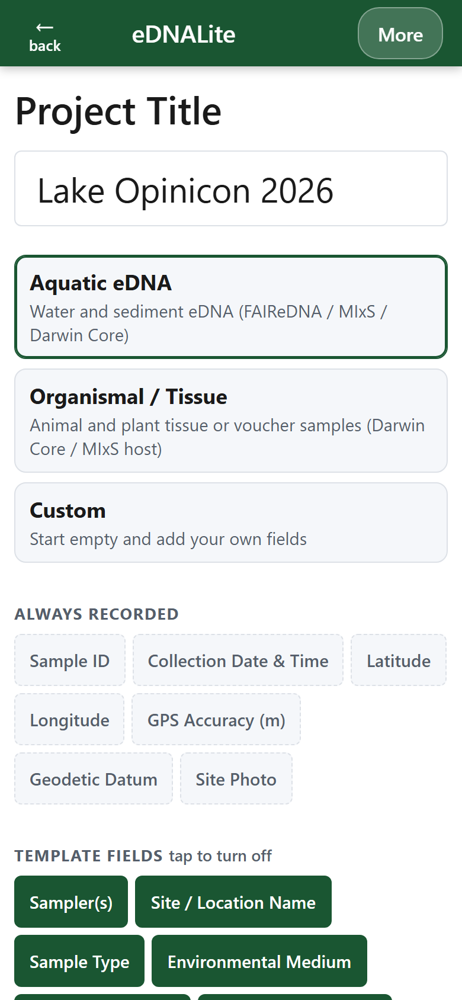
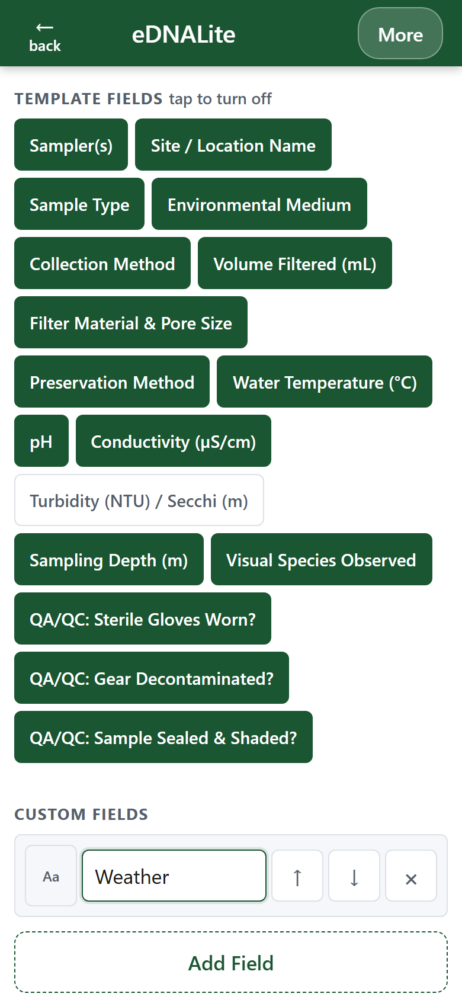
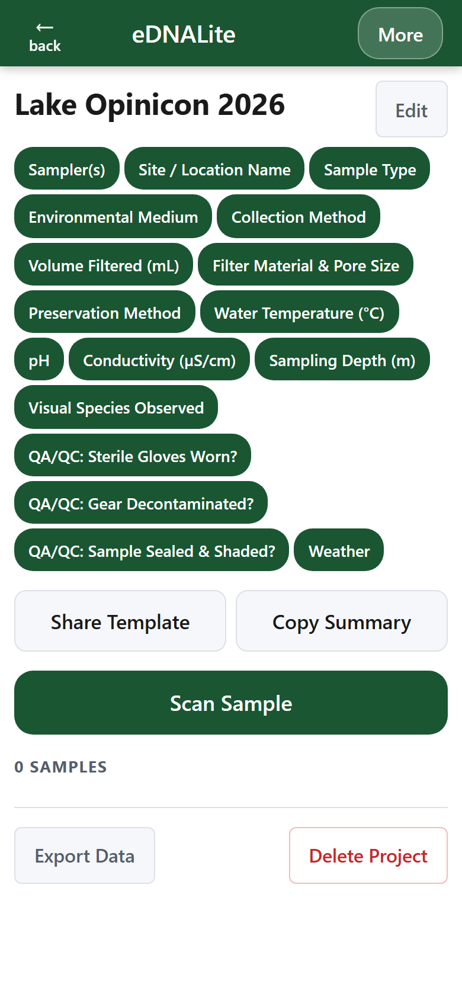
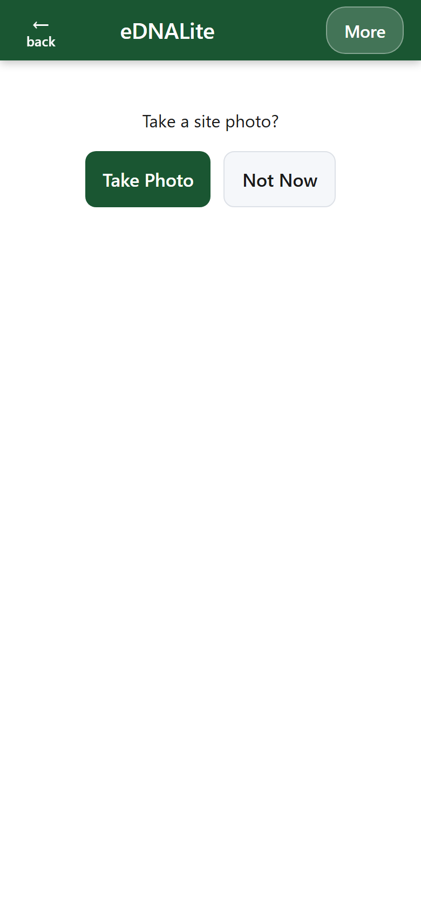
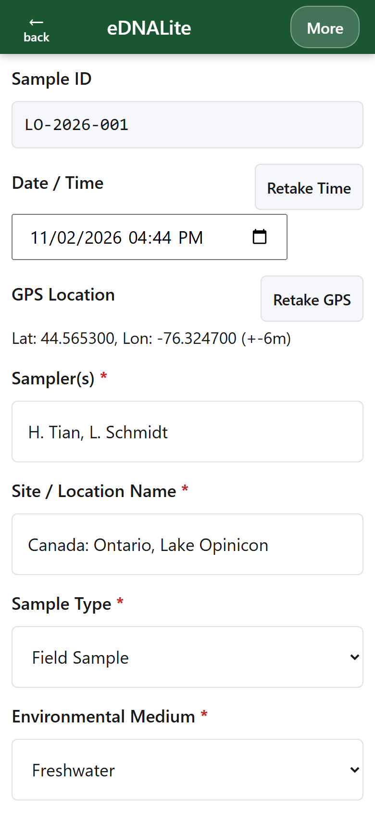
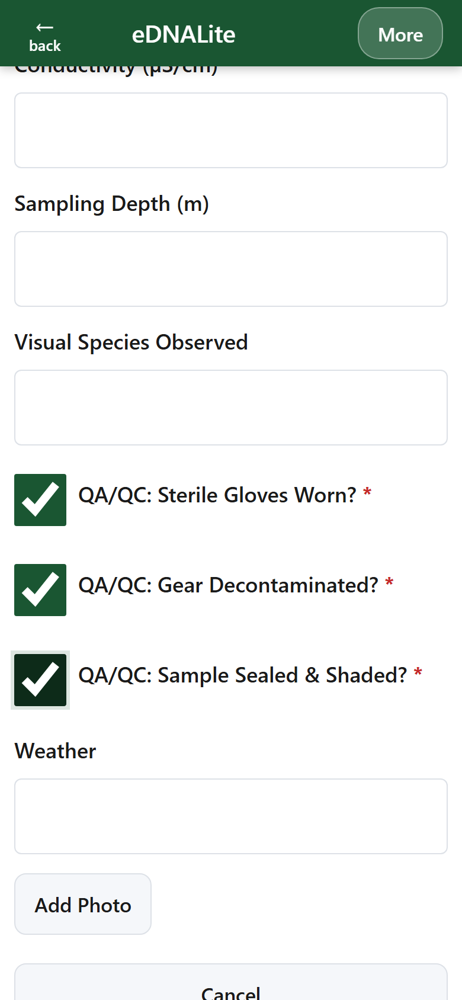
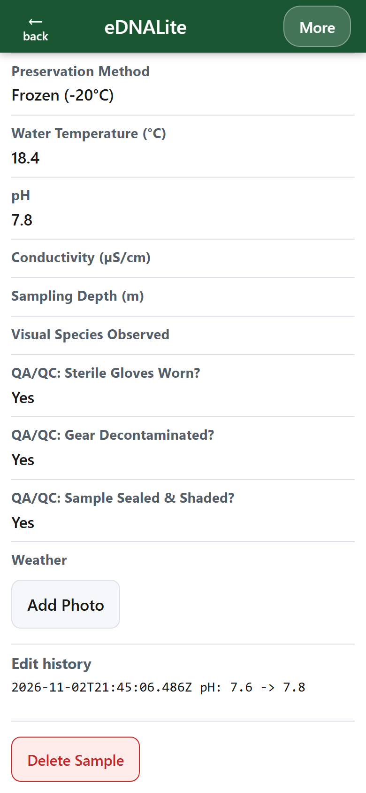
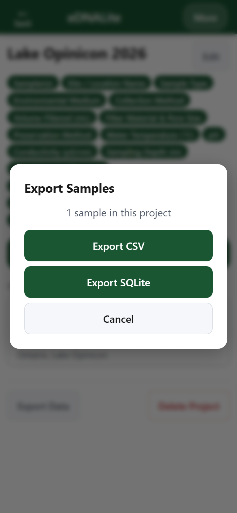

# eDNALite

[](https://doi.org/10.5281/zenodo.19477477) [](./LICENSE)

Offline-first Progressive Web App for field technicians to log environmental DNA (eDNA) sample metadata. Set up projects with custom metadata fields, scan sample QR codes in the field, auto-capture GPS coordinates, and export FAIR-compliant datasets as CSV or SQLite.

Live app: https://isrudev.github.io/eDNABook/

## Why eDNALite

Field eDNA collection traditionally relies on paper datasheets, phone photos of labels, and manual transcription once you are back at the bench. Errors compound at every step. eDNALite runs entirely in your browser, works offline, and produces exports with Darwin Core column headers that are ready to load into GBIF, NCBI, or any bioinformatics pipeline that speaks standard metadata terms.

## Tutorial: Making Your Field Data FAIR with eDNALite

While eDNALite allows for infinite metadata customization, ensuring your data is FAIR (Findable, Accessible, Interoperable, and Reusable) requires your exported column headers to match established global standards.

This guide demonstrates how to configure your eDNALite project to align with **Darwin Core (DwC)** and **MIxS-eDNA** standards for seamless database integration.

### Step 1: The Auto-Generated Fields

You do not need to create fields for temporal or spatial data. To reduce transcription errors, eDNALite records these for every sample automatically:

- **Sample ID** — Captured when you scan the QR code on the sample container (or typed with **Enter ID Manually**).
- **Collection date and time** — The device clock, exported as an ISO 8601 timestamp. **Retake Time** resets it to now.
- **Latitude and longitude** — WGS84 decimal degrees from the device GPS, with the horizontal accuracy in meters. GPS works without cell service. The fix shows as locked at 15 m or better and as a warning above that; **Retake GPS** discards the fix and starts over.
- **Site photo** — Optional. **Not Now** skips it; the photo's filename is stored with the sample.

### Step 2: Choosing a Template

When you create a project, pick a starting template:

- **Aquatic eDNA** — water and sediment eDNA (FAIRe / MIxS / Darwin Core).
- **Organismal / Tissue** — animal and plant tissue or voucher samples.
- **Custom** — start empty.

Each template field is a button: tap it to turn it off for this project. Add your own fields under **Custom Fields**. The full field list, with the Darwin Core and MIxS term each field maps to, is in [docs/eDNALite_Templates.md](docs/eDNALite_Templates.md).

Controlled-vocabulary fields are pick lists, so every sampler records the same spelling. Renaming a field later never loses the values already recorded under it.

To give every collector the same fields, tap **Share Template** on the project dashboard and send the file. Collectors open **More → Import Template** to create the same project, so their exports have matching columns. **Copy Summary** copies a plain-text paragraph that lists every field with its unit and standard terms, ready for a methods section.

### Step 3: Enforcing Sample Integrity (QA/QC)

Contamination tracking is critical for robust eDNA methodology. Template fields marked with a red asterisk are required, and the QA/QC checkboxes (for example **Sterile Gloves Worn?** and **Gear Decontaminated?**) must be checked before a sample can be saved. Custom checkboxes can be added for your own protocols.

Editing a saved sample never overwrites the original silently: every change is recorded with its time, old value, and new value, shown as **Edit history** on the sample and exported in an `edit_log` column.

### Step 4: Export and Backup

When you return from the field, tap **Export Data** on a project dashboard and choose CSV or SQLite. Exports include every field, the photo filename, and the `edit_log` column. Example exports for both templates are in [examples/](examples/).

eDNALite stores data only on the device. Nothing is synced to a server when connectivity returns, so export and back up your CSV or SQLite files after each sampling day.

## Walkthrough

Generated from the current app with `npm run screenshots` (see [Development](#development)).

| | |
| :---: | :---: |
|  |  |
| 1. Choose a template | 2. Turn fields off, add custom fields |
|  |  |
| 3. Project dashboard | 4. Site photo, or Not Now |
|  |  |
| 5. Sample entry with GPS fix | 6. Required QA/QC checkboxes |
|  |  |
| 7. Edit history after a correction | 8. Export to CSV or SQLite |

## Installation

eDNALite is a Progressive Web App — there is nothing to install from an app store. Visit the [live app](https://isrudev.github.io/eDNABook/), then use your browser's **Add to Home Screen** option:

- **iOS (Safari):** Tap the Share icon, then *Add to Home Screen*.
- **Android (Chrome):** Tap the menu, then *Install app* or *Add to Home Screen*.

Once added, the app works fully offline after the first load. In-app, the **More → Offline Access** menu contains platform-specific install guidance.

## Development

eDNALite is built as static files with **no build step** — vanilla JavaScript, HTML, and CSS served directly by any HTTPS-capable static host. Everything the app needs at runtime (including third-party libraries in `lib/`) is in this repository.

Requirements: Node.js 18 or newer (tests only) and Python 3 (or any static file server).

```bash
# Clone the repo
git clone https://github.com/isruDev/eDNABook.git
cd eDNABook

# Install test tooling (Vitest, Playwright)
npm install
npx playwright install chromium

# Serve locally (any static file server works)
python -m http.server 8080

# Run the unit test suite
npm test

# Run the end-to-end suite (starts its own server on port 8080)
npx playwright test

# Regenerate the README walkthrough screenshots (SCHEME=dark for dark mode)
npm run screenshots

# Rebuild the example exports in examples/ after an export change
npm run examples
```

Open `http://localhost:8080` in a modern browser. The service worker and camera APIs require a secure origin, so localhost or an HTTPS deployment is required.

### Releasing

The service worker serves cached files until its cache name changes. `npm run hotfix` runs the full test suite and, only if it passes, bumps `CACHE_NAME` in `sw.js`. Commit `sw.js` with the change; installed apps pick it up after one reload.

### Tech stack

- Vanilla JavaScript ES modules (no bundler, no transpiler)
- IndexedDB via [`idb`](https://github.com/jakearchibald/idb) for local storage
- [`html5-qrcode`](https://github.com/mebjas/html5-qrcode) for in-browser QR scanning
- [`sql.js`](https://github.com/sql-js/sql.js) (SQLite compiled to WebAssembly) for SQLite export
- [`papaparse`](https://www.papaparse.com/) for CSV generation
- Service Worker with a cache-first precache strategy for offline support
- Vitest + Playwright for testing

### Repository layout

```
index.html          SPA shell and view containers
js/app.js           Hash-based router, service worker registration
js/db.js            IndexedDB CRUD (projects + samples)
js/field-model.js   Field definitions, built-in fields, required-field checks
js/templates.js     Aquatic eDNA and Organismal / Tissue templates
js/edit-log.js      Non-destructive edit history (diff + export formatting)
js/export.js        CSV and SQLite export
js/gps.js           Continuous high-accuracy GPS watch (15 m lock threshold)
js/views/           View render functions (home, project form, dashboard, ...)
css/style.css       All styles, dark-mode tokens, animations
sw.js               Service worker (versioned precache)
lib/                Vendored third-party libraries
docs/               Template field list, term verification, walkthrough images
examples/           Example CSV, SQLite, and template files for each template
scripts/            Release (hotfix), screenshot, and example-export scripts
tests/              Vitest unit and integration tests
e2e/                Playwright end-to-end specs
```

## Citation

If you use eDNALite in published research, please cite the archived release. The concept DOI below always resolves to the latest version on Zenodo; use a version-specific DOI if you need to cite an exact release for reproducibility.

> Tian, H., & Schmidt, L. (2026). *eDNALite*. Zenodo. https://doi.org/10.5281/zenodo.19477477

BibTeX:

```bibtex
@software{tian_schmidt_2026_ednalite,
  author    = {Tian, Haolun and Schmidt, Luke},
  title     = {eDNALite},
  year      = 2026,
  month     = apr,
  publisher = {Zenodo},
  doi       = {10.5281/zenodo.19477477},
  url       = {https://doi.org/10.5281/zenodo.19477477}
}
```

GitHub also supports citation export via the **Cite this repository** button on the repo sidebar, which reads from [`CITATION.cff`](./CITATION.cff).

## Support

Bug reports, feature requests, and questions go in the [GitHub issue tracker](https://github.com/isruDev/eDNABook/issues).

## License

Released under the MIT License — see [LICENSE](./LICENSE) for the full text.

## Contributing

Pull requests are welcome. Please open an issue before starting non-trivial work so we can align on scope.
